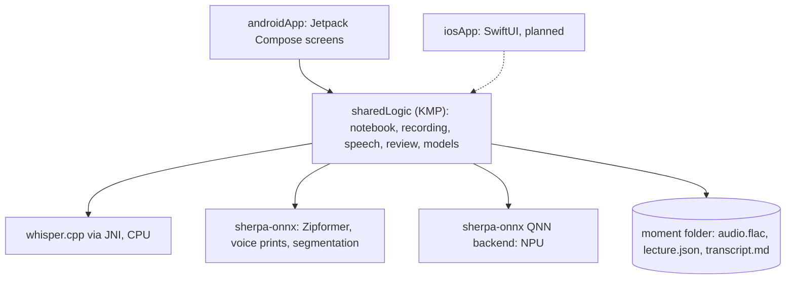

# Audio Logs (repository name: transcriptor-kmp)

A Kotlin Multiplatform app that records a conversation and transcribes it on the phone with local speech recognition
models, Hebrew first, including Whisper running on the Qualcomm NPU. No audio or text leaves the device.

## At a glance

- **Problem:** good Hebrew transcription usually means sending recordings to a cloud service. This app keeps
  everything on the phone and still uses the strongest open Hebrew models.
- **What it does:** records a conversation, transcribes it live, labels the speakers, and lets you write notes while
  it keeps transcribing. Afterwards a larger model can refine the transcript. Export to Markdown and Word.
- **On-device speech recognition:** Whisper through whisper.cpp (JNI bridge) and a streaming Zipformer transducer
  through sherpa-onnx. Models are downloaded at a pinned commit and checked by sha256.
- **NPU inference:** ivrit.ai Whisper large-v3 turbo compiled for the Snapdragon 8 Elite's NPU (Qualcomm QNN /
  Hexagon HTP), with a CPU fallback on every other phone.
- **Speaker diarization:** voice-print embeddings with pyannote segmentation, live during the recording and as a
  pass afterwards.
- **Measurements** (Galaxy S25, from the project's own notes in [docs/design.md](docs/design.md), not reproducible
  from this repository alone): 6.5 s of Hebrew speech transcribed in about 2.3 s on the CPU. On a 41-minute
  recording the NPU is about 2 times as fast as the CPU at about a fifth of the energy.
- **Tests:** 148 unit tests in 17 files for the shared logic, run on the JVM.
- **Size:** about 12,000 lines of Kotlin outside the tests.

**Stack:** Kotlin, Kotlin Multiplatform (KMP), Jetpack Compose, Material 3, coroutines, kotlinx.serialization, okio,
Android NDK / JNI / C++ (CMake), whisper.cpp, sherpa-onnx, ONNX, Qualcomm QNN (QAIRT) / Hexagon NPU, model
quantization, on-device ML, automatic speech recognition (ASR), Whisper, speaker diarization, speaker embeddings,
MediaCodec (FLAC), Android foreground services, Storage Access Framework, Hugging Face Hub, Gradle, Docker, unit
tests. iOS (SwiftUI) is planned on the same shared logic.

## My role

This is my own project (Hen Cohen). I made the product and technical decisions, which are dated and explained in
[docs/design.md](docs/design.md): which models and why, the audio and data formats, what runs on the NPU. I build it
with AI coding agents (Claude Code) under the standing rules in [CLAUDE.md](CLAUDE.md). Part of the commit history
is authored by the agent directly, and the rest was written in agent sessions under my account and review. Larger
pieces of work arrive as pull requests that I review and merge.

## Architecture



- **UI:** holds no logic. Shared controllers expose state and the screens render it.
- **Shared logic:** recording, transcription, speakers, review and the model catalog, with the unit tests.
- **Native engines:** the platform code implements small interfaces (`SpeechEngine`, `StreamingEngine`,
  `AudioRecorder`).
- **Storage:** one folder per recording holds the audio, a versioned `lecture.json` and a readable `transcript.md`.

The full diagram, key files and the models table are in [docs/ARCHITECTURE.md](docs/ARCHITECTURE.md).

## Quick start

Requirements: JDK 21, the Android SDK and NDK, and an arm64 Android device or emulator (the app builds for
`arm64-v8a`, minimum SDK 35).

```sh
git clone https://github.com/chencohensolutions/transcriptor-kmp.git
cd transcriptor-kmp
git submodule update --init          # whisper.cpp, pinned to a release
./gradlew :androidApp:assembleDebug  # the build downloads the pinned sherpa-onnx AAR
```

Install the debug APK, then download a model in Settings › Models before recording.

## Tests

```sh
./gradlew :sharedLogic:testAndroidHostTest   # 148 shared-logic tests on the JVM
```

Screens are checked on a device through the UI lab. There is no CI workflow yet.

## Status

Early but working on Android. Started Nov 2, 2026.

- **Built (Android):** recording with the screen off, live transcription, speaker labels, notes, review with
  playback and editing, the refine pass, notebooks, model management, NPU inference on the Snapdragon 8 Elite, and
  Markdown and Word export.
- **Not built:** the iOS app. The shared logic already builds for iOS. The SwiftUI app follows when Android is
  finished ([docs/ios-todo.md](docs/ios-todo.md)).
- **Open:** the oldest phone to support, NPU builds for other chips, a w8a16 build of large-v3 that fits the phone's
  memory, and separating overlapping speech.

## More docs

- [docs/ARCHITECTURE.md](docs/ARCHITECTURE.md): full diagram, key files, models table, measurements, what is built.
- [docs/design.md](docs/design.md): design decisions, formats and speaker models.
- [docs/npu-plan.md](docs/npu-plan.md) and [docs/npu-build.md](docs/npu-build.md): NPU plan, results and build steps.
- [docs/screens/](docs/screens/README.md) and [docs/ux-history/](docs/ux-history/README.md): screens and UI lab rounds.
- [CLAUDE.md](CLAUDE.md): rules for AI coding agents working in this repository.

## License

Free for noncommercial use under the [PolyForm Noncommercial License 1.0.0](LICENSE.md). For commercial use, ask for a
separate license. Third-party code and the speech models keep their own licenses.
