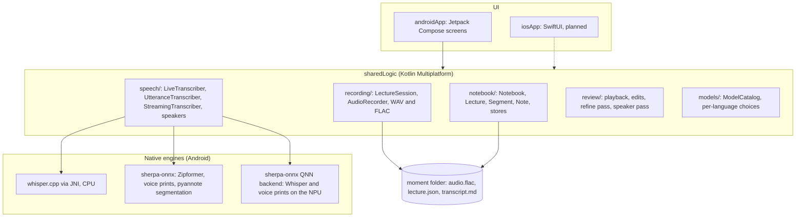

# Audio Logs: architecture and details

Detail moved out of the [README](../README.md). Paths in code blocks and inline code are relative to the repository
root.

## What the app does, in more detail

- **Problem:** good Hebrew transcription usually means sending recordings to a cloud service. This app keeps
  everything on the phone and still uses the strongest open Hebrew models.
- **What it does:** each recording is a **moment**. The app records it (WAV or FLAC, 48 kHz stereo, 16 bit),
  transcribes it live, labels the speakers, and lets you write notes while it keeps transcribing. Every line of
  speech and every note carries its time in the recording. Afterwards a larger model can refine the transcript, and
  any line can be played back and corrected. Export to Markdown and Word.
- **On-device speech recognition:** Whisper through whisper.cpp (JNI bridge in
  [androidApp/src/main/cpp/](../androidApp/src/main/cpp/)), and a streaming Zipformer transducer through sherpa-onnx.
  Models are downloaded from their publishers at a pinned commit and checked by sha256.
- **NPU inference:** ivrit.ai Whisper large-v3 turbo compiled for the Snapdragon 8 Elite's NPU (Qualcomm QNN /
  Hexagon HTP), with a CPU fallback on every other phone. The build scripts and a patched sherpa-onnx AAR are in
  [scripts/npu/](../scripts/npu/); the method is in [docs/npu-build.md](npu-build.md).
- **Speaker diarization:** voice-print embeddings (3D-Speaker CAM++ and others) with pyannote segmentation, live
  during the recording and as a pass afterwards; named voices are remembered per notebook.
- **Measurements recorded in [docs/design.md](design.md)** (on a Galaxy S25; from the project's own notes, not
  reproducible from this repository alone):
  - ivrit.ai Whisper turbo, quantized to q8_0 on the phone: 6.5 s of Hebrew speech transcribed in about 2.3 s on the
    CPU. Fitting the encoder window to the line instead of Whisper's fixed 30 s made it about 5 times faster.
  - The same model on the NPU, on a 41-minute recording: about 2 times as fast as the CPU and about a fifth of the
    energy.
  - The NPU build of the ERes2NetV2 voice-print model matches the CPU model at cosine similarity 0.99996 or more.
- **Tests:** 148 unit tests in 17 files for the shared logic
  ([sharedLogic/src/commonTest/](../sharedLogic/src/commonTest/kotlin/com/chencohensolution/transcriptor/)), run on the
  JVM with `./gradlew :sharedLogic:testAndroidHostTest`.
- **Size:** about 12,000 lines of Kotlin outside the tests.

## How it is built

The app is built with AI coding agents (Claude Code), and the repository is set up for that:

- [CLAUDE.md](../CLAUDE.md) holds the standing rules: logic goes in the shared module with tests, the UIs only render
  state; Android first, with an [iOS to-do list](ios-todo.md) kept as Android grows; Hebrew and right-to-left
  layout checked on every screen; models pinned and hash-checked.
- UI changes go through a **UI lab**: several tappable options are mocked in debug-only code, the author picks one on the
  phone, and only then is it promoted into the app. Each round is written up in
  [docs/ux-history/](ux-history/README.md).
- Larger pieces of work arrive as pull requests that the author reviews and merges. Part of the commit history is authored by
  the agent directly; the rest was written in agent sessions under the author's account and review.

The NPU work shows the engineering approach: measuring on the phone before compiling anything, finding
that one model's NPU build drifted from its CPU output and dropping it, and adding a memory guard so a model too big
for the phone is refused instead of crashing the app ([docs/npu-plan.md](npu-plan.md)).

## Architecture diagram (full)

The UIs hold no logic: shared controllers expose state, and the platform code implements small interfaces
(`SpeechEngine`, `StreamingEngine`, `AudioRecorder`). One folder per moment holds the audio, a versioned
`lecture.json` and a readable `transcript.md`. The user-facing name is Audio Logs and a recording is a "moment"; the
code still says `Transcriptor` and `Lecture`.

Key files and docs:

| Area | Where |
|---|---|
| Design decisions, formats, what is built | [docs/design.md](design.md) |
| Screens | [docs/screens/](screens/README.md) |
| NPU: plan and results, build steps | [docs/npu-plan.md](npu-plan.md), [docs/npu-build.md](npu-build.md), [scripts/npu/](../scripts/npu/) |
| Shared logic | [sharedLogic/src/commonMain/](../sharedLogic/src/commonMain/) |
| Unit tests | [sharedLogic/src/commonTest/](../sharedLogic/src/commonTest/kotlin/com/chencohensolution/transcriptor/) |
| Whisper JNI bridge | [androidApp/src/main/cpp/whisper_jni.cpp](../androidApp/src/main/cpp/whisper_jni.cpp) |
| Agent rules | [CLAUDE.md](../CLAUDE.md) |

## Models

Everything runs on the phone; the network is only used to download models. Models are chosen per language in
Settings › Models: one for live transcription, one for refining afterwards.

| Model | Languages | Size | License | Use |
|---|---|---|---|---|
| [ivrit.ai Whisper large-v3 turbo](https://huggingface.co/ivrit-ai/whisper-large-v3-turbo) | Hebrew | 809M params | Apache-2.0 | Live |
| [ivrit.ai Zipformer streaming](https://huggingface.co/ivrit-ai/zipformer2-66m-streaming-he) (by Yakov Kolani) | Hebrew | 66M params | CC-BY-4.0 | Live (streaming) |
| [ivrit.ai Whisper large-v3](https://huggingface.co/ivrit-ai/whisper-large-v3) | Hebrew | 1.55B params | Apache-2.0 | Refine |
| [Whisper large-v3 turbo](https://huggingface.co/openai/whisper-large-v3-turbo) | ~100 languages | 809M params | MIT | Live |
| [Whisper large-v3](https://huggingface.co/openai/whisper-large-v3) | ~100 languages | 1.55B params | MIT | Refine |

Speaker models (voice prints and segmentation) and their licenses are listed in [docs/design.md](design.md).

## Running and testing

More commands (emulator, UI lab) are in [CLAUDE.md](../CLAUDE.md).

The tests cover the shared logic: splitting speech into lines, streaming transcription, speaker tracking and the
speaker pass, the refine pass, recording and file formats, notebooks, the model catalog and Hugging Face client, the
NPU memory guard, power metering and the Word export. Screens are checked on a device through the UI lab. There is no
CI workflow yet.

## What is built

- **Built (Android):** recording with the screen off, live transcription (Whisper by line, Whisper in 30 s windows,
  streaming Zipformer), live speaker labels and the speaker pass, notes, review with playback and editing, the refine
  pass with transcript versions, notebooks, model management with models added from Hugging Face, NPU inference on
  the Snapdragon 8 Elite, power reports per recording, Markdown and Word export.
- **Not built:** the iOS app. The shared logic already builds for iOS; the SwiftUI app follows when Android is
  finished ([docs/ios-todo.md](ios-todo.md)).
- **Open:** the oldest phone to support, NPU builds for other chips, a w8a16 build of large-v3 that fits the phone's
  memory, separating overlapping speech.
